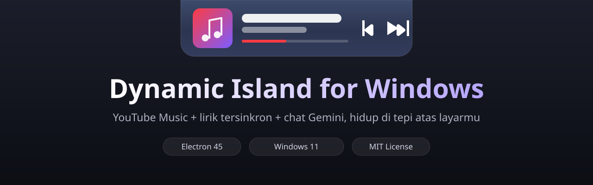

<p align="center">
  
</p>

<h1 align="center">Dynamic Island for Windows</h1>

<p align="center">
  Dynamic Island ala iPhone/macOS untuk <b>Windows 11</b> — pill kaca yang nempel di tepi atas layar,
  berisi <b>YouTube Music</b> yang bisa login Premium langsung di dalam aplikasi, <b>lirik tersinkron</b>,
  kontrol volume laptop asli, dan <b>chat AI Gemini</b> dengan screenshot.
</p>

---

## Fitur

- **Island hidup ala Apple** — mode idle (jam), mode musik, panel aplikasi, dan chat; membesar/mengecil dengan animasi pegas khas Dynamic Island, plus auto-hide yang muncul lagi saat kursor menyentuh tepi atas layar atau lagu berganti.
- **YouTube Music tertanam penuh** — login Google langsung di dalam aplikasi (pola yang sama dengan ytmdesktop: Electron modern + identitas standar + alur login in-view), jadi akun Premium kamu kepakai tanpa membuka Chrome. Jalur cadangan lewat ekstensi Chrome / script Tampermonkey juga tersedia (`extension/`, `bridge/`).
- **Kaca yang mengikuti musik** — warna latar island mengalir halus mengikuti warna dominan cover lagu yang sedang diputar, datanya diambil dari Media Session API (judul/artis/cover selalu segar, termasuk habis skip).
- **Lirik tersinkron (LRCLIB)** — tombol lirik membuka panel lirik yang barisnya menyala mengikuti lagu + auto-scroll, dan **setiap baris bisa diklik untuk melompat** ke bagian itu.
- **Volume laptop asli** — slider volume Windows beneran (Core Audio), bukan volume internal player.
- **Chat Gemini** — tanya apa saja atau lampirkan screenshot (`Ctrl+Shift+A`). Daftar model dimuat langsung dari API key kamu (termasuk **Gemini 4 Argon** untuk key API berbayar), ada tombol tes koneksi, rantai cadangan anti-503 yang otomatis pindah model saat server penuh, dan tombol **stop** untuk membatalkan jawaban yang sedang ditulis.
- **Ringan** — polling adaptif, penjaga kursor yang tidur saat tidak dibutuhkan, penahan jeda audio yang hanya aktif saat lagu bermain, dan penulisan DOM yang digerbangi perubahan nilai.

## Pintasan keyboard

| Pintasan | Fungsi |
| --- | --- |
| `Ctrl+Shift+A` | Screenshot + buka chat Gemini |
| `Ctrl+Shift+M` | Buka/tutup panel YouTube Music |
| `Ctrl+Shift+H` | Sembunyikan/tampilkan island sekarang |
| `Esc` | Keluar dari panel / chat / lirik |

## Cara menjalankan (mode dev)

```powershell
git clone https://github.com/RobbyDarmawann/dynamic-island-windows.git
cd dynamic-island-windows
npm install
npm start
```

API key Gemini diisi sekali dari ikon gear di panel chat (dari [Google AI Studio](https://aistudio.google.com/apikey)) — key tersimpan **hanya di PC kamu** (`userData`), tidak pernah masuk ke repo ini.

## Build jadi .exe

```powershell
npm run dist
```

Hasilnya ada di folder `dist\`: installer **Dynamic Island Setup 1.15.0.exe** (autostart otomatis setelah terpasang) dan versi **portable** sekali klik.

> **Catatan ikon:** taruh file PNG 512×512 bernama `icon.png` di folder `assets\` sebelum build (file binernya tidak disimpan di repo ini). Secara default build memakai `signAndEditExecutable: false` supaya selalu selesai **tanpa terminal admin** — konsekuensinya ikon file .exe/installer memakai bawaan Electron (ikon di dalam aplikasi & tray tetap ikon Dynamic Island). Mau ikon .exe-nya juga custom? Jalankan `npm run dist:admin` dari terminal **sebagai Administrator** (atau dengan Developer Mode Windows aktif).

> **Troubleshooting:** kalau build gagal di langkah mengekstrak `winCodeSign` dengan pesan *"Cannot create symbolic link: A required privilege is not held by the client"*, itu Windows kamu belum mengizinkan symlink untuk proses biasa. Solusinya salah satu: jalankan terminal **sebagai Administrator**, atau aktifkan **Developer Mode** (Settings → System → For developers). Setelah itu hapus folder `%LOCALAPPDATA%\electron-builder\Cache\winCodeSign` lalu ulangi `npm run dist`.

## Teknologi

Electron 45 (Chromium terbaru — penting agar login Google tidak ditolak), vanilla JS tanpa framework, Windows Core Audio via PowerShell, LRCLIB API untuk lirik, Gemini API untuk chat.

## Struktur proyek

```
main.js          Proses utama: jendela island, view YT Music, bridge, Gemini, lirik, volume
preload.js       Jembatan aman renderer <-> main (contextBridge)
renderer/        UI island (bar, panel musik, lirik, chat)
extension/       Ekstensi Chrome cadangan (remote YT Music dari Chrome)
bridge/          Script Tampermonkey cadangan
assets/          Banner repo (ikon aplikasi: lihat catatan build)
docs/            Catatan pengembangan versi demi versi
```

## Privasi

Tidak ada data yang dikirim ke mana pun selain layanan yang memang kamu pakai (YouTube Music, Gemini API dengan key kamu sendiri, LRCLIB untuk lirik). Tidak ada analytics, tidak ada server pihak ketiga.

## Lisensi

MIT — lihat [LICENSE](LICENSE).

---

<p align="center"><i>Dibangun sebagai proyek iseng yang kebablasan jadi serius, oleh Robby Darmawan.</i></p>
